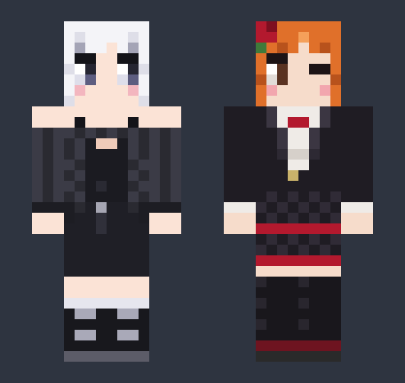

# Kotost Skins

Two Minecraft skins (slim, 64×64) by Kotost Games, and a resource pack that shows them in
[Horizon](https://playhorizon.dev) (or any Minecraft: Java Edition 26.3).

| Skin | File | Who |
| --- | --- | --- |
| KotostGames | [`skins/kotost/kotost_skin.png`](skins/kotost/kotost_skin.png) | Kotost Games's own character: white hair, black dress, no mouth. |
| Bolvanchik | [`skins/bot/bot_skin.png`](skins/bot/bot_skin.png) | The companion bot: red hair, black jacket, red tie. |

Both are slim skins (3-pixel arms). Use them as your own skin in the official launcher (Skins → New skin → Slim).

## The resource pack: it replaces two default skins

`resourcepack/` (and `kotost_skins-<version>.zip` in Releases) **replaces two of the game's default skins**, the ones
players without a skin of their own get (offline servers, no account skin):

- `slim/makena` → **Bolvanchik**
- `slim/noor` → **KotostGames**

So on your screen every player who would look like the default Makena looks like Bolvanchik, and every default Noor
like KotostGames. Which default skin a player gets is picked from their UUID: on an offline server the names
`Bolvanchik` and `KotostGames` get exactly these two. Players with their own skin are not touched. It changes only
what you see; other players see it only with the pack on.

Install: put the zip in the `resourcepacks` folder of your game folder and turn it on in Options → Resource Packs.
Pack format 97.1 (26.3).

## License

MIT, see [LICENSE](LICENSE): use, change and share the skins and the pack. Not affiliated with Mojang or Microsoft.
